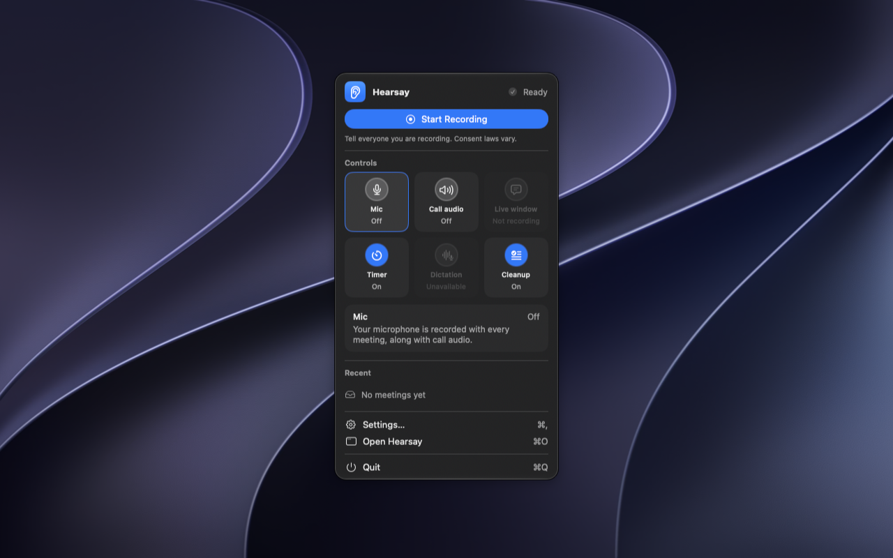

# Hearsay

A macOS menu bar app that records your meetings and writes speaker-labelled transcripts as plain files to `~/Meetings`. Everything runs on the Mac: transcription (Parakeet), speaker diarization, voice matching, filler cleanup and summaries. Nothing leaves the machine except the first-run model download.



Hearsay cannot announce itself to the other people on a call. Telling them they are being recorded is your responsibility under the consent laws that apply to you, and the app reminds you of that wherever a recording can start.

## Install

Requires macOS 26 or later on Apple Silicon.

```sh
brew install --cask vrennat/tap/hearsay
```

This puts `Hearsay.app` in `/Applications` and a `hearsay` command on your `PATH`. Or download `Hearsay-<version>.zip` from the [releases page](https://github.com/vrennat/hearsay/releases). A Mac App Store build is in progress.

On first launch grant Microphone, System Audio Recording and (for meeting detection) Calendar access. Dictation also needs Accessibility.

## What it does

- **Records both sides.** Your mic and the system audio of the call, as separate tracks, with the system side captured through a Core Audio process tap. No virtual audio driver and no admin rights.
- **Transcribes locally.** Parakeet, through FluidAudio, with on-device summaries from Apple Foundation Models. A live transcript is written every two seconds so a crash never loses a meeting.
- **Labels speakers.** Diarization per track, voice embeddings that recognise people you have named before, and calendar attendees as naming suggestions. Nothing is renamed without you.
- **Writes files you can read.** One folder per meeting: `transcript.md`, `meeting.json`, the audio as AAC, plus an `index.md` across meetings. Agents and scripts need no API, just the folder.
- **Keeps what you tell it to.** Retention rules per data type, recordings encrypted at rest by default with a key in your login Keychain, optional password encryption of the transcripts, and audio deleted on schedule once a transcript exists.
- **Dictation.** Hold Right Option anywhere and talk. The text is pasted into the focused app and never saved.

## Command line

`hearsay` ships inside the app bundle. It processes, imports, cleans up, renames, re-indexes and exports meetings in `~/Meetings`, and `hearsay dictate <wav>` tests the dictation path without the hotkey. Run `hearsay --help` for the list. A Claude Code skill for reading the transcripts lives in `claude/skills/meeting-transcripts`, see `docs/INSTALL-SKILL.md`.

## Build from source

```sh
DEVELOPER_DIR=/Applications/Xcode.app/Contents/Developer swift build
DEVELOPER_DIR=/Applications/Xcode.app/Contents/Developer swift test
scripts/build-app.sh        # signs and installs Hearsay.app (Developer ID or ad-hoc)
```

An unsigned `swift run` binary cannot record system audio, so audio paths are tested through the installed app or through CLI commands fed a WAV file. See `docs/RELEASING.md` for the release process.

## Documents

- `docs/SPEC.md` is the specification and the authority on behaviour.
- `CLAUDE.md` records the decisions behind the code and why they were made.
- `docs/RECORDING-CHECKLIST.md` is the manual test pass before a release.

MIT licensed.
